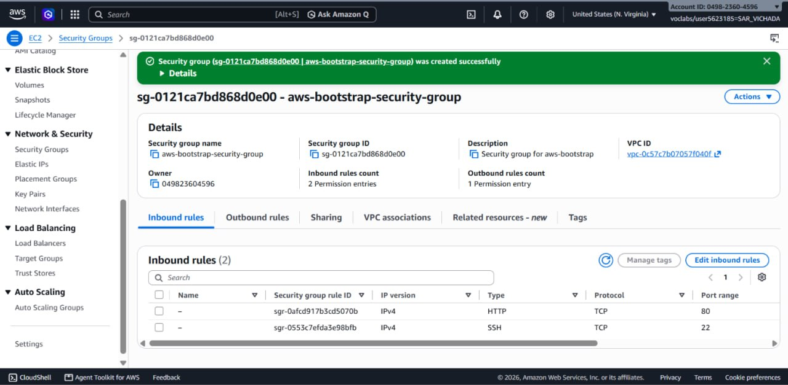
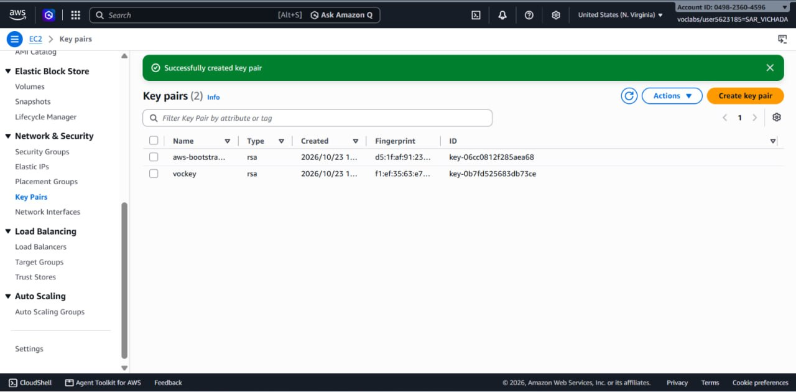
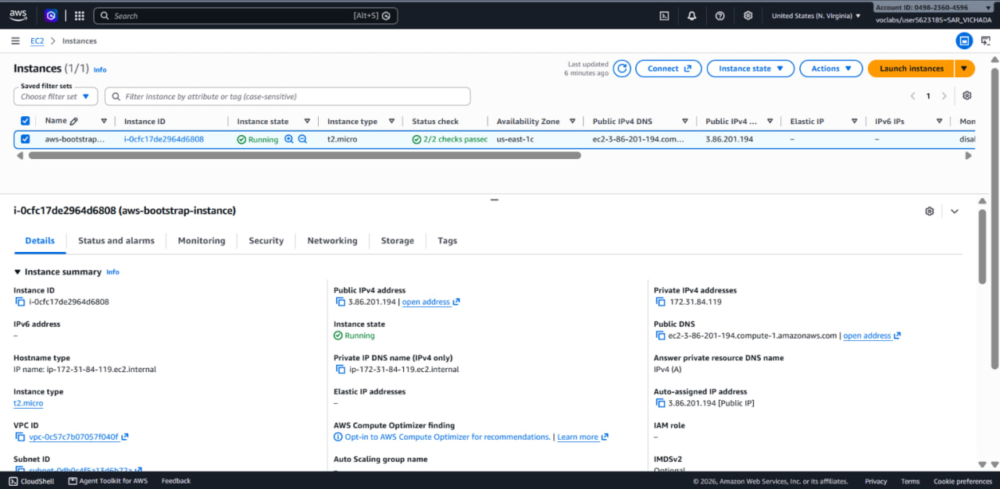
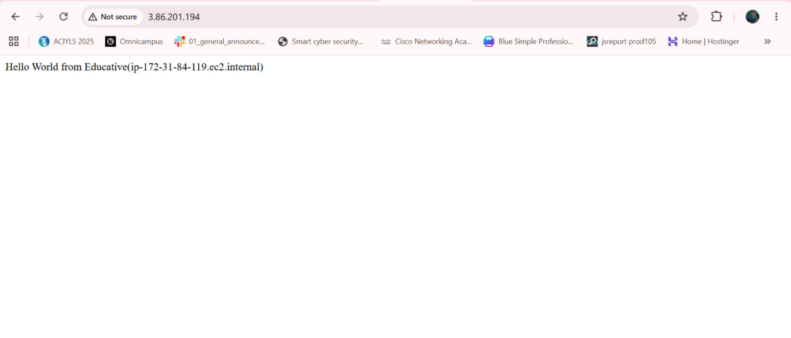
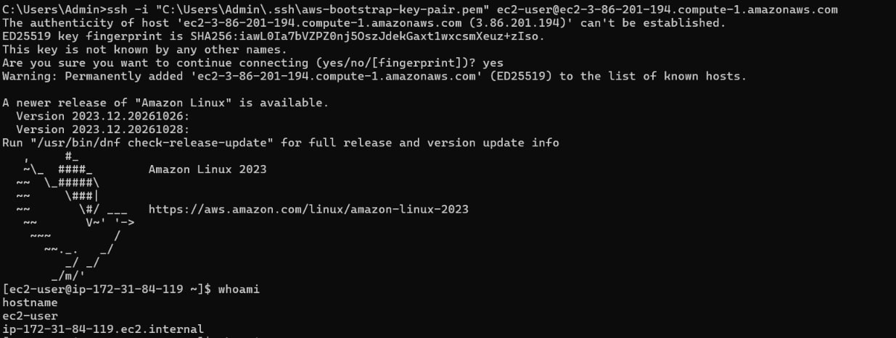
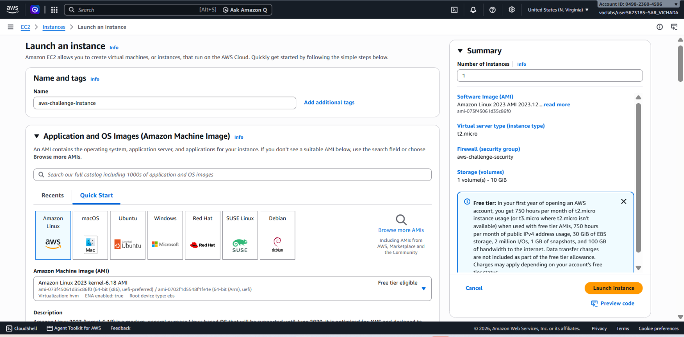
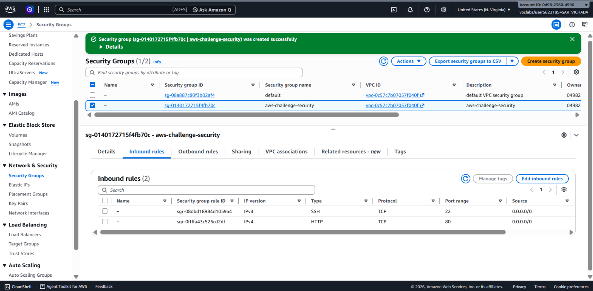
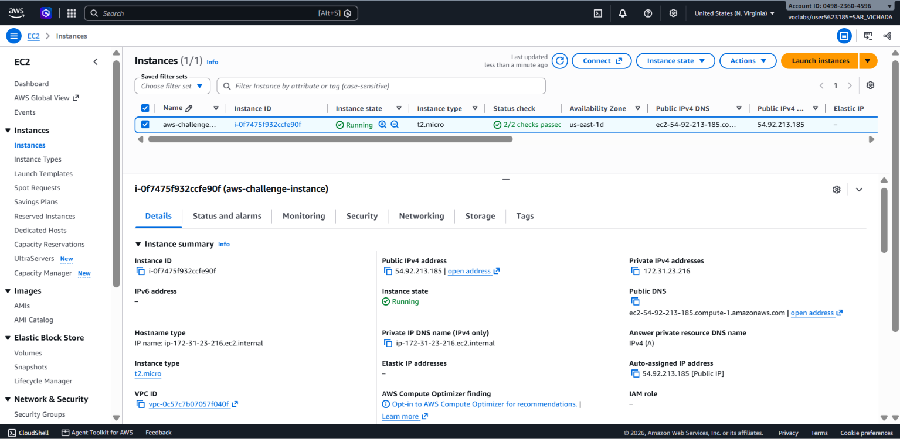
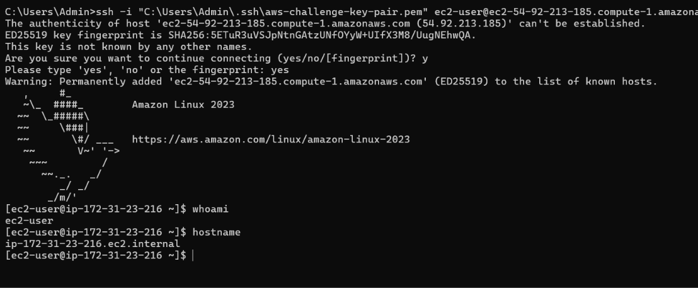
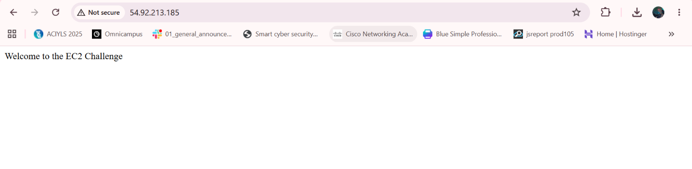

# Cloud Lab 1 Submission — Amazon EC2

- **Student name: Sar Vichada**
- **Student ID: e20220514**
- **Learner Lab user name: SAR_VICHADA**
- **Date completed: 30 October 2026**

---

## Part 1.1 — An Amazon EC2 Walkthrough

### Security group



### Key pair



### Instance details



### Browser test



### SSH connection



I connect using my own SSH client from my computer with the .pem key file.

---

## Part 1.2 — EC2 Web Solution (Challenge)

### Launch configuration



### Security group



### Running instance



### Commands on the instance



Paste the commands you ran to install the web server and create `index.html`:

```bash
sudo dnf update -y
sudo dnf install -y nginx
sudo systemctl enable --now nginx
sudo systemctl status nginx
echo 'Welcome to the EC2 Challenge' | sudo tee /usr/share/nginx/html/index.html
```

### Browser test



---

## Questions

1. Your security group has an SSH rule and an HTTP rule. What does each one let you do? What would stop working if you deleted the HTTP rule?

   => The SSH rule allows me to connect to and manage my EC2 instance remotely using port 22. The HTTP rule allows users to access my web page through a browser using port 80. If I deleted the HTTP rule, users would no longer be able to access my web page through HTTP from outside the instance, even if the web server was still running.

2. In Part 1.1 you never logged in to install the web server. What installed it, and when did it run?

   => The user data script installed the Apache web server automatically when the EC2 instance launched. The script ran during the instance's startup process, so I did not need to log in and install the web server manually.

3. Why does the web page open with `http://` but not with `https://`?

   => The web page opens with HTTP because the web server is configured to accept HTTP requests on port 80. HTTPS normally uses port 443 and requires HTTPS configuration, including a TLS certificate. Since I did not configure HTTPS for this challenge, the web page works with HTTP but not HTTPS.

4. Part 1.2 asked for a 10 GiB root volume. Where in the launch settings did you set it, and how can you check the size on the running instance?

   => I set the root volume size to 10 GiB in the Storage section of the EC2 launch settings. The launch summary showed one volume with a size of 10 GiB. I can also check the volume size in the AWS Console under EC2 → Elastic Block Store → Volumes or use the lsblk command on the running Linux instance.

## Problems and how I solved them (optional)

During the lab, I learned how to configure an EC2 instance, set up security group rules, and install Nginx. I also learned how to create a web page and test it using the instance's public IP address. I used the terminal to run the required commands and checked the result using a web browser.

## Clean up

- [x] Part 1.1: instance terminated, key pair and security group deleted.
- [x] Part 1.2: instance terminated, security group (and key pair, if any) deleted.
