# Cloud Lab 2 Submission — Load Balancer and Auto Scaling

- **Student name: Sar Vichada**
- **Student ID: e20220514**
- **Learner Lab user name: SAR_VICHADA**
- **Date completed: 30 October 2026**

---

## Security groups

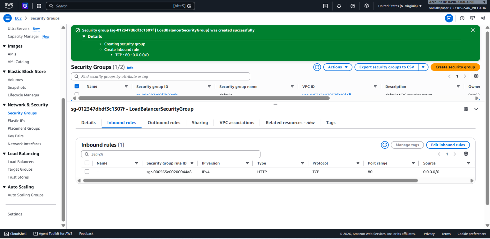

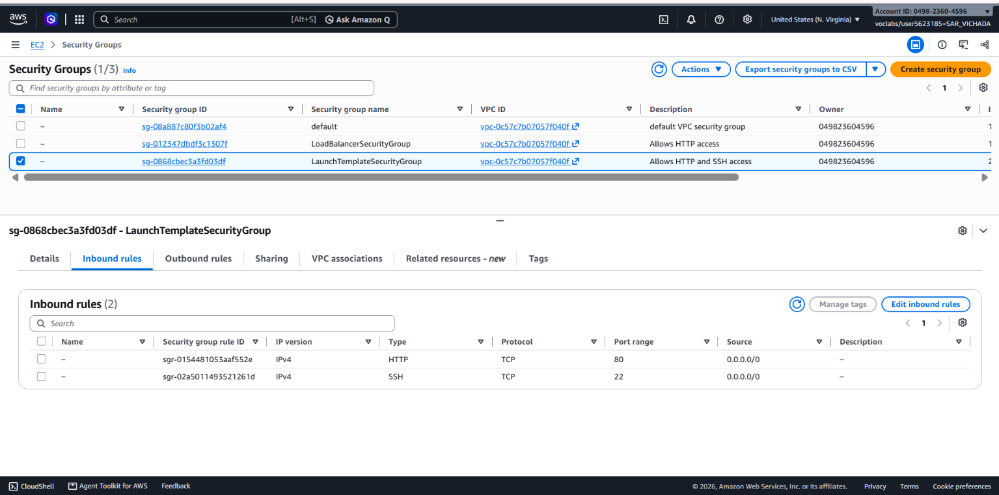

## Target group

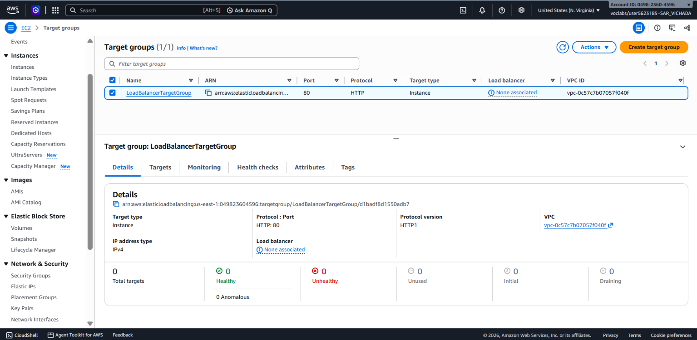

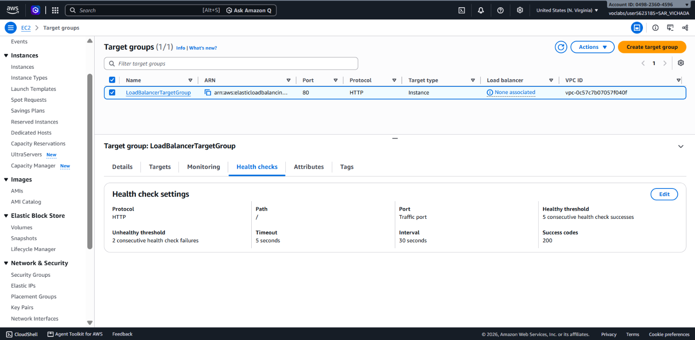

## Application Load Balancer

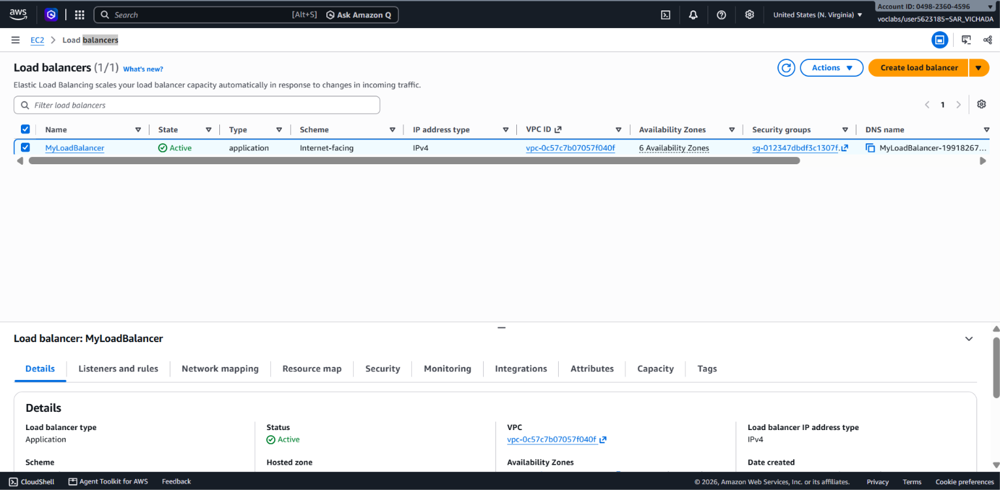

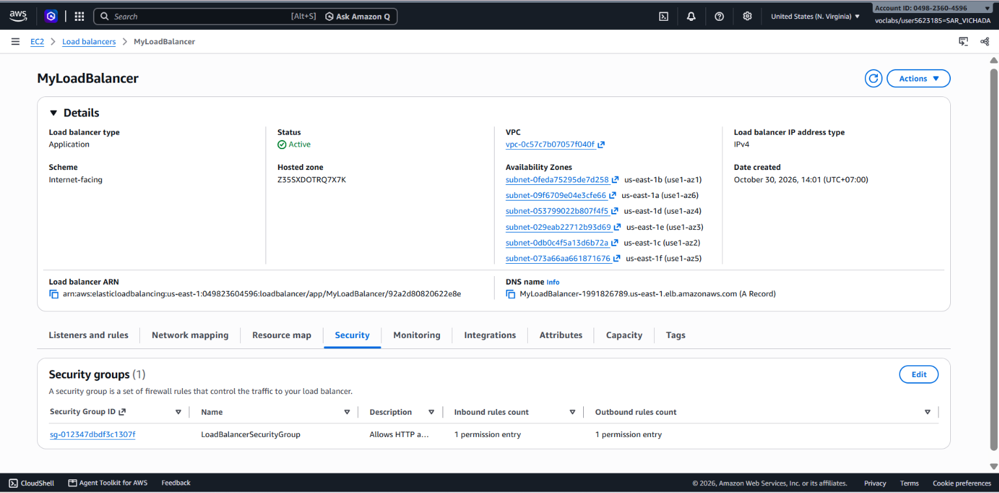

## Launch template

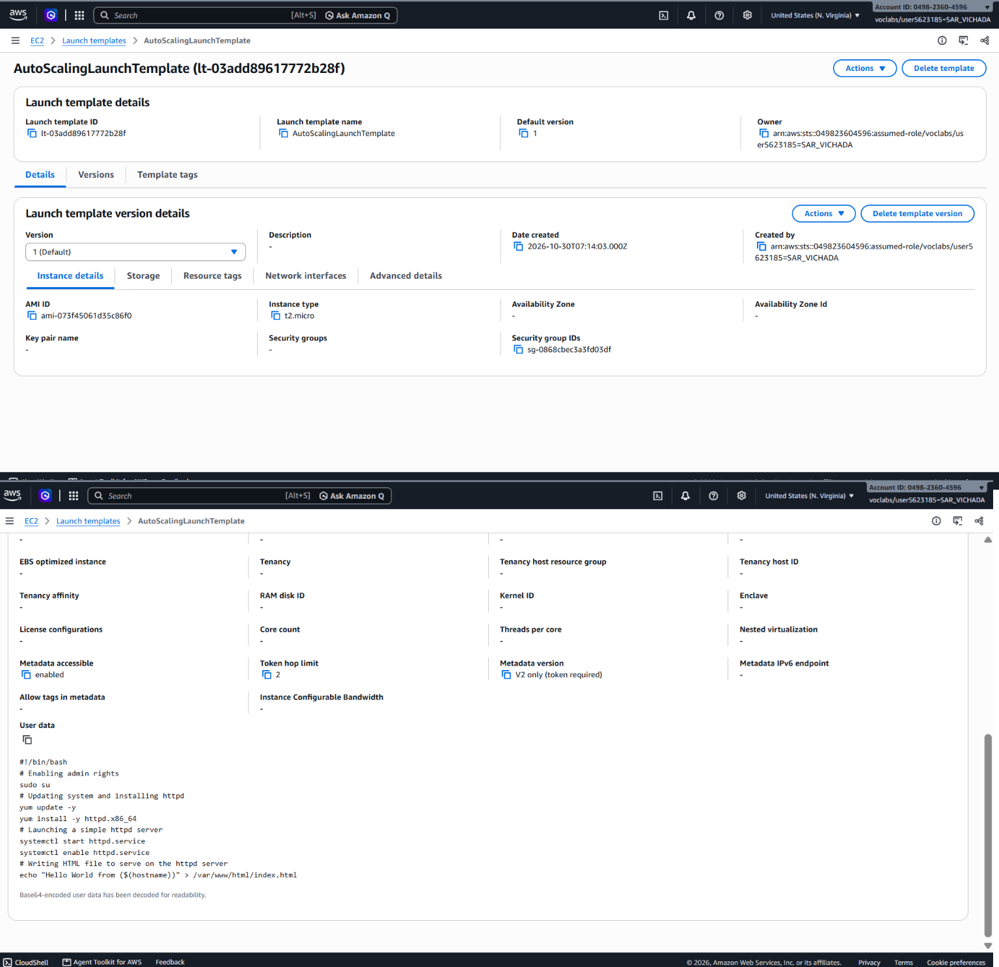

## Auto Scaling group

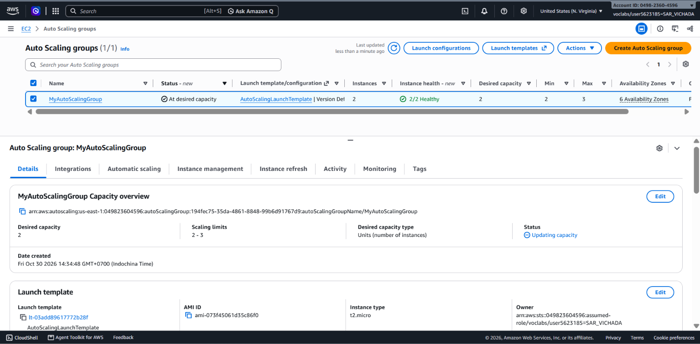

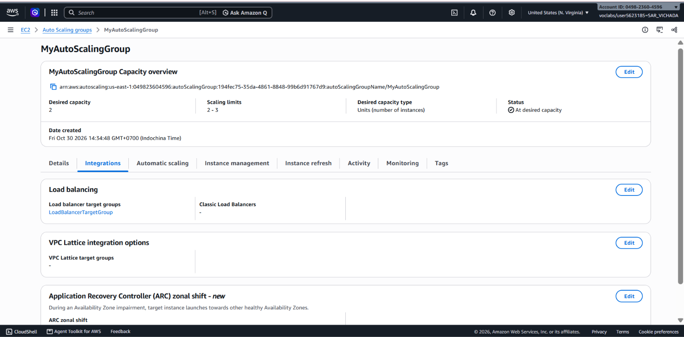

## Load balancing test

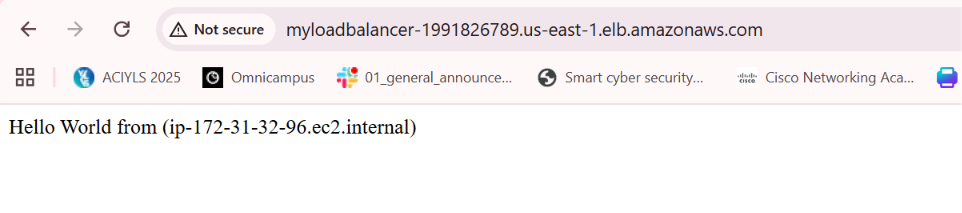

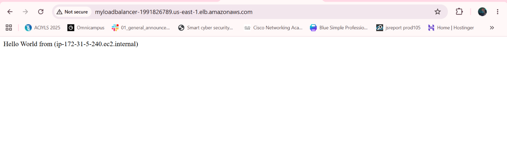

## Simulated application failure

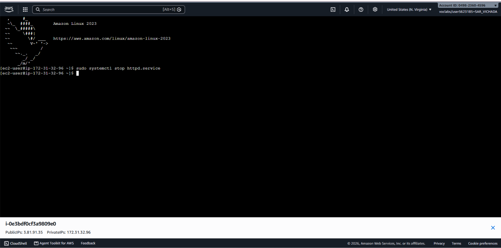

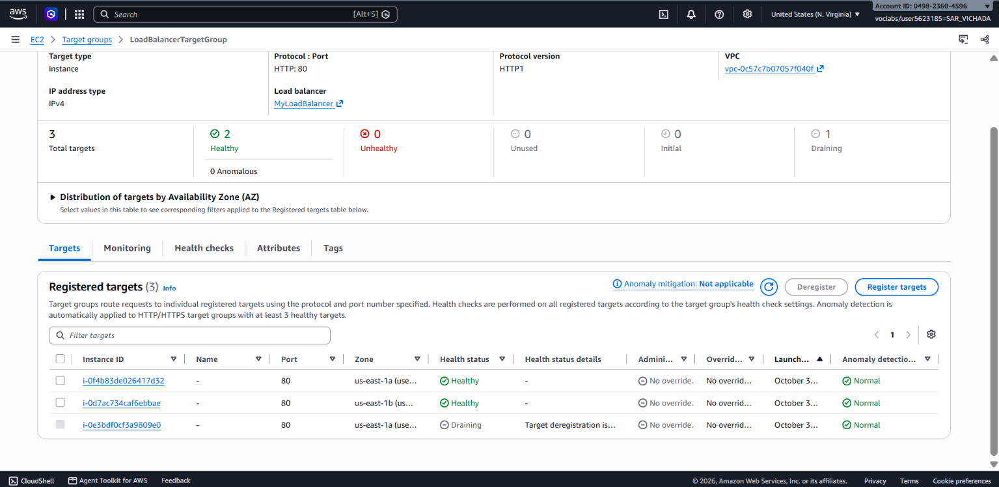

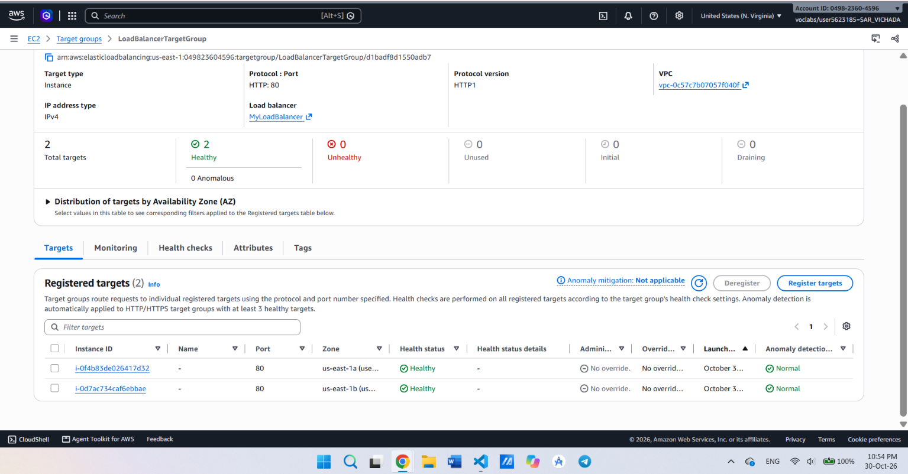

About how many minutes passed between stopping `httpd` and the new instance becoming healthy?

=> About 7 minutes. I stopped `httpd` at about 22:44, and the new instance was already healthy at about 22:51. This is an estimate because I did not note the exact time.

---

## Questions

1. Why does the page show a different host name when you refresh it?

   => There are two instances, and each one has its own host name. The load balancer shares the requests between the healthy instances. When I refresh, a different instance can answer, so I see a different host name.

2. After you stopped `httpd`, the instance was still _running_ in EC2, but the target group marked it _unhealthy_. What did the health check test, and why did the instance fail it?

   => The health check sends an HTTP request to the path `/` every 30 seconds. It expects the answer 200. After I stopped `httpd`, nothing answered on port 80, so the check failed. After two failed checks in a row, the target became unhealthy. The instance was still running, but the web application was stopped. The health check tests the application, not only the instance.

3. Who replaced the failed instance: the load balancer, the target group, or the Auto Scaling group? Explain the role of each one.

   => The Auto Scaling group replaced it. - The load balancer receives the requests and sends them only to healthy targets. - The target group keeps the list of targets and runs the health checks. It marked the instance unhealthy. - The Auto Scaling group has ELB health checks turned on. It saw the unhealthy instance, removed it, and launched a new one to keep the desired capacity of 2. The new instance was registered in the target group.

4. With desired 2, minimum 2 and maximum 3, how many instances run normally? In what situation could there be 3?

   => Normally 2 instances run. There could be 3 if the desired capacity is raised to 3, by hand or by a scaling policy when the load is high. In this lab there is no scaling policy, so it would only happen if someone changes the desired capacity.

5. The instances' security group allows HTTP from anywhere. How could you change it so that the instances accept HTTP **only** from the load balancer?

   => I would edit the inbound rules of `LaunchTemplateSecurityGroup`. For the HTTP rule, I would change the source from `0.0.0.0/0` to the security group `LoadBalancerSecurityGroup`. Then only the load balancer can reach port 80 on the instances.

## Clean up

- [x] `MyAutoScalingGroup` deleted and its instances terminated.
- [x] `AutoScalingLaunchTemplate` deleted.
- [x] `MyLoadBalancer` and `LoadBalancerTargetGroup` deleted.
- [x] Both security groups deleted.
