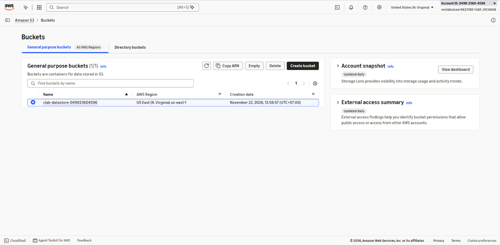
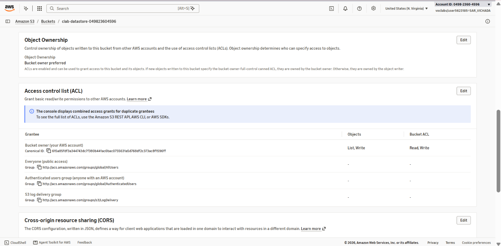
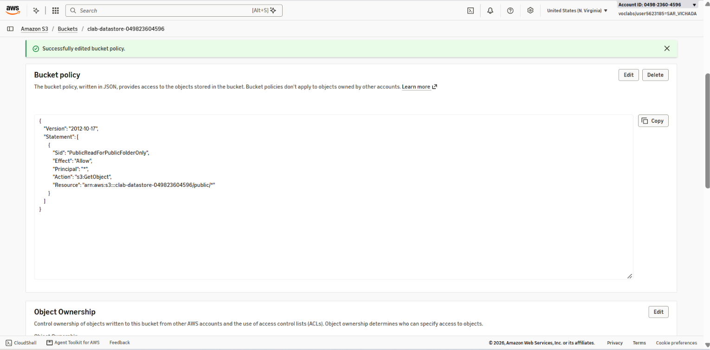
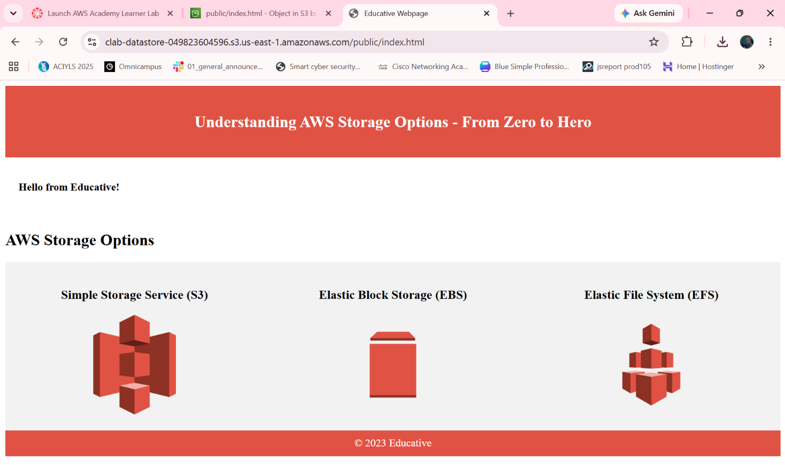
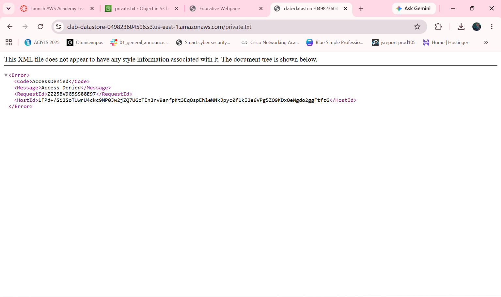
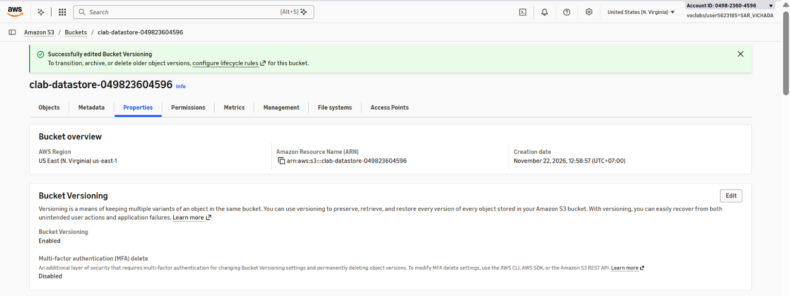
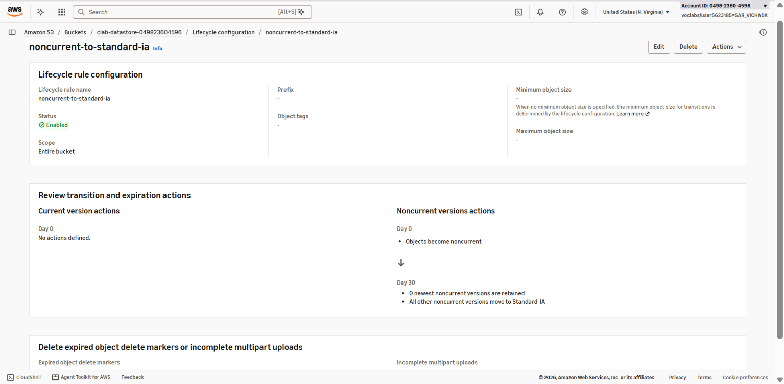

# Cloud Lab 3 Challenge Submission — Secure S3 Bucket

- **Student name: Sar Vichada**
- **Student ID: e20220514**
- **Learner Lab user name: SAR_VICHADA**
- **Bucket name: clab-datastore-049823604596**
- **Date completed: 22 November 2026**

---

## 1. Bucket



---

## 2. Object ownership



---

## 3. Public access policy

### Bucket policy



### Public object loaded in the browser



### Private object denied



My policy is in [bucket-policy.json](bucket-policy.json).

**Which line limits public access to the `public/` folder?**

> **Answer:** The `Resource` line:
>
> ```json
> "Resource": "arn:aws:s3:::clab-datastore-YOUR_NUMBER/public/*"
> ```
>
> It only covers objects whose key starts with `public/`. Objects at the root and in other folders have no matching `Allow`, so they stay private.

---

## 4. Versioning



---

## 5. Lifecycle rule



---

## Questions

**1. You turned off parts of Block Public Access for this bucket. Why was that needed, and why is it still safe for the objects outside `public/`?**

> **Answer:** The two Block Public Access settings about bucket policies block any public bucket policy. With them on, my policy that allows everyone to read `public/*` would not work. So I turned off only those two.
>
> It is still safe because the policy allows only `public/*`. Every other object has no `Allow`, so S3 denies it by default. I also kept the two ACL-related settings on, so an ACL cannot make an object public by mistake. My test confirmed it: a file at the bucket root gave `AccessDenied`.

---

**2. What is a noncurrent version? Give an example from your own test.**

> **Answer:** When versioning is on and I upload an object with the same name again, the new upload becomes the current version, and the older one becomes a noncurrent version. S3 keeps it instead of overwriting it.
>
> In my test, I uploaded `public/index.html`, then changed the heading `Hello from Educative!` to `Hello from Educative! v2` and uploaded it again. The first file became the noncurrent version. I could see both versions with **Show versions** turned on.

---

**3. Why move noncurrent versions to S3 Standard-IA instead of deleting them?**

> **Answer:** Old versions are useful for going back to an earlier page or for checking what changed. If I delete them, that history is gone. Standard-IA costs less per GB than Standard for data that is rarely read, so I keep the history at a lower cost. The trade-off is a small fee when I read an old version, which should be rare.

---

## AI note (optional)

An AI tool suggested turning off only the two Block Public Access settings for bucket policies and keeping the two ACL settings on. I checked it by opening the object URL of a file in the bucket root, which gave `AccessDenied`, and the object URL of `public/index.html`, which loaded.

## Clean up

- [x] All object versions deleted and the bucket deleted.
