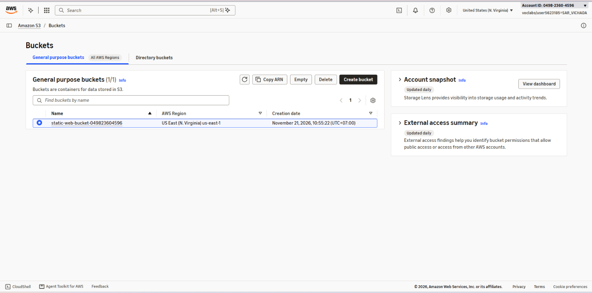
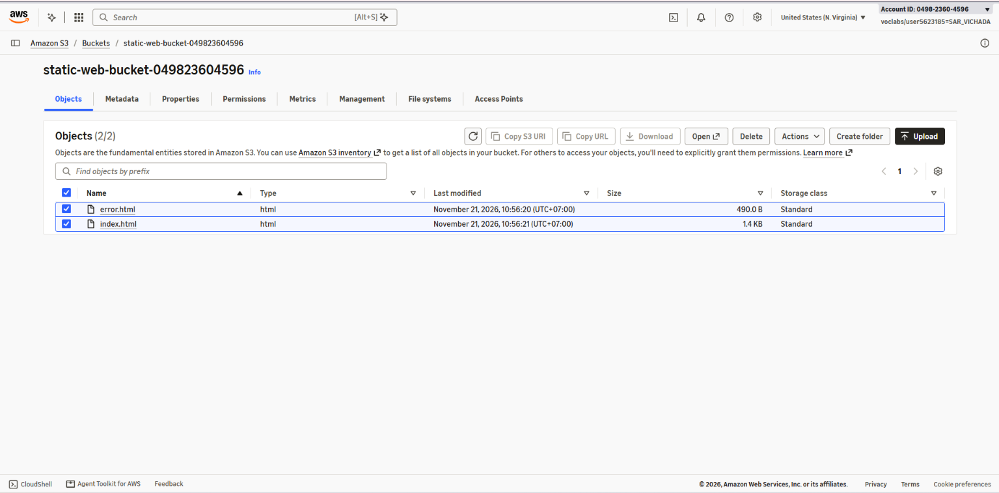
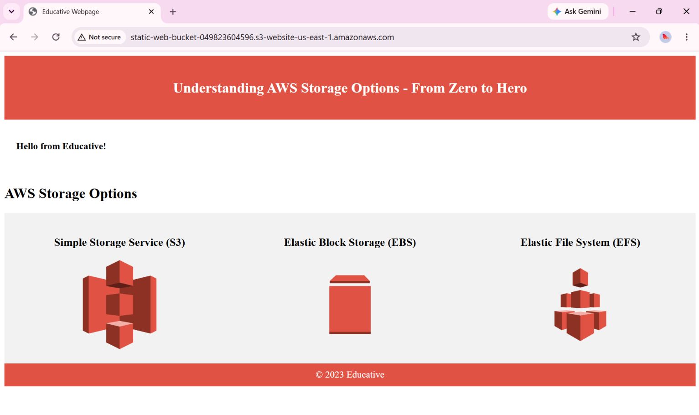
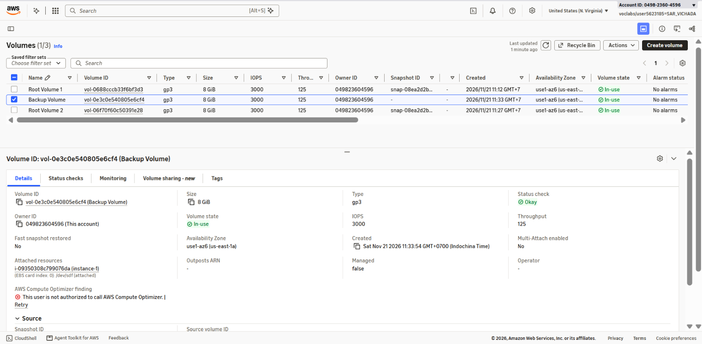
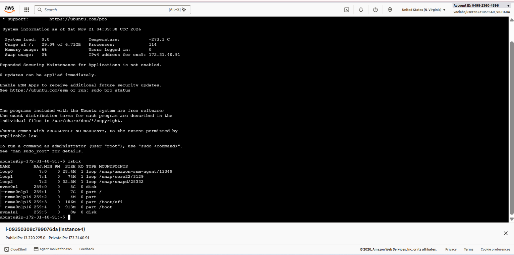
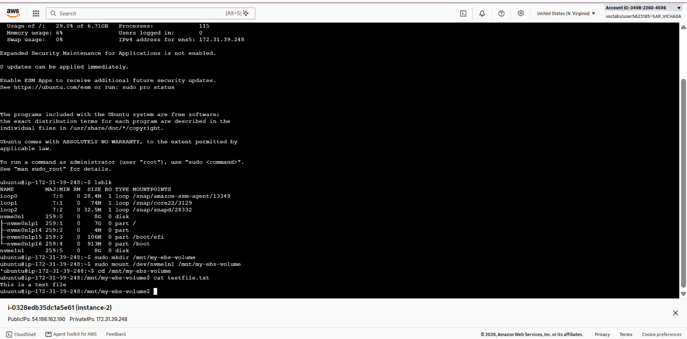
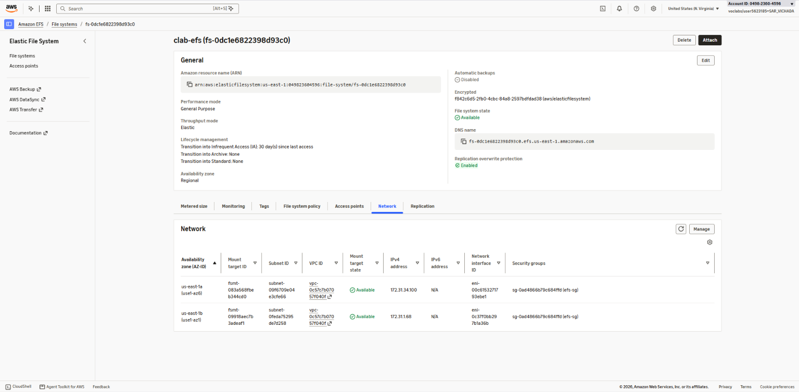
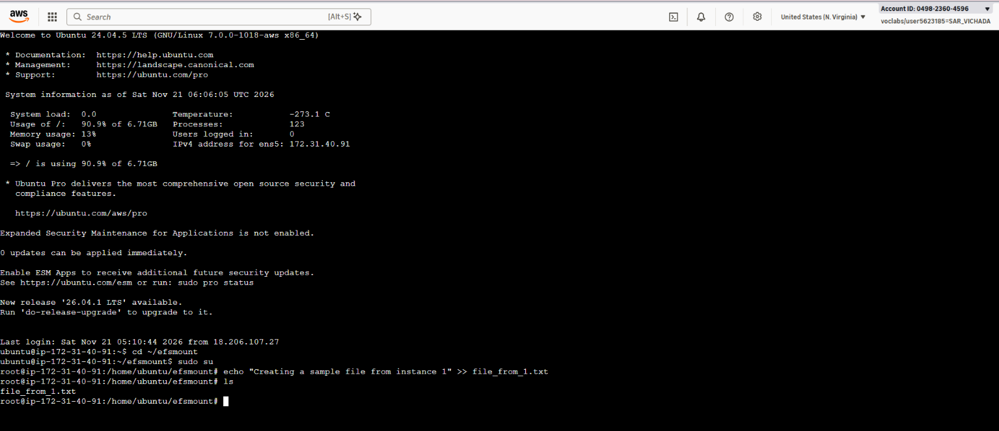
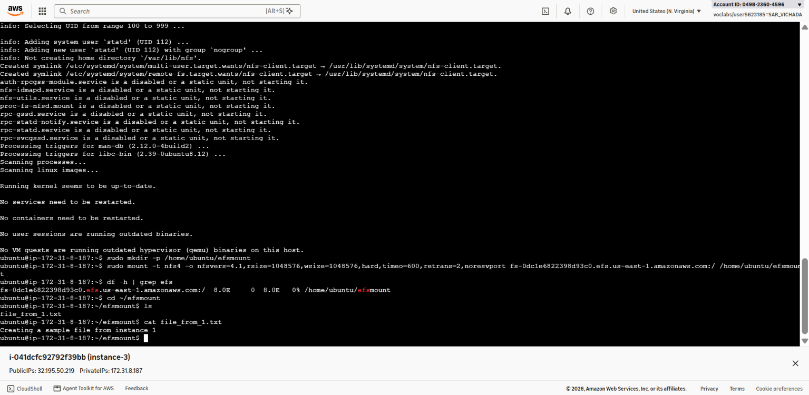

# Cloud Lab 3 Submission — AWS Storage Options

- **Student name:** Sar Vichada
- **Student ID:** e20220514
- **Learner Lab user name:** SAR_VICHADA
- **Date completed:** 21 November 2026

---

## Part 2.1 — Amazon S3

### Bucket list

### Uploaded files

### Static website

---

## Part 2.2 — Amazon EBS

### Volumes page

### Attached volume (`lsblk`)

**Which device name did your volume get (`xvdf`, `nvme1n1`, ...)?**

> **Answer:** I got `nvme1n1`. I attached it as `/dev/sdf` in the console, but my instance type (t3.medium) uses NVMe disks, so Linux shows it as `nvme1n1`. The root disk is `nvme0n1`.

### File read on instance-2

---

## Part 2.3 — Amazon EFS

### File system and mount targets

### File created on instance-1

### File listed on instance-3

---

## Questions

**1. After you turned on static website hosting, the endpoint first answered 403 Forbidden. Why, and what changed after you added the bucket policy?**

> **Answer:** S3 objects are private by default. Turning off Block Public Access only removes the block. It does not give anyone permission to read the files, so I got 403. After I added the bucket policy that allows everyone (`Principal: *`) to do `s3:GetObject` on the bucket objects, the website showed the `index.html` page.

---

**2. `testfile.txt` was still there after you moved Backup Volume to `instance-2`. What would have happened to a file saved on `instance-1`'s root volume after terminating `instance-1`?**

> **Answer:** The file would be lost. The root volume is deleted when the instance is terminated. Backup Volume is an extra volume, so it stays and can be attached to another instance.

---

**3. Why did you run `mkfs` on `instance-1` but not on `instance-2`?**

> **Answer:** Backup Volume was blank when I first attached it, so it needed a file system (ext4). On `instance-2` it already had a file system and my file. Running `mkfs` again would erase the data, so I only mounted it.

---

**4. Why could `instance-1` and `instance-3` use the EFS file system at the same time, when an EBS volume had to be detached first? Why did they have to be in the subnets of the mount targets?**

> **Answer:** EBS is like a hard disk, so it can be attached to only one instance at a time. EFS is a shared network file system (NFS), so many instances can use it together. Each instance connects through the mount target in its own zone. A mount target has an IP address in one subnet, so the instances had to be in those subnets (us-east-1a and us-east-1b).

---

**5. For each need, choose S3, EBS or EFS and give one reason: (a) a website's images, (b) the disk of a database server, (c) a folder shared by several web servers.**

> **Answer:**
> - **(a) S3:** it stores files as objects with a URL, and it is cheap and scalable.
> - **(b) EBS:** it works like a fast disk for one server.
> - **(c) EFS:** many servers can mount it at the same time and see the same files.

---

## Problems and how I solved them (optional)

- I first launched `instance-2` in us-east-1b. A volume can only attach in its own zone, so I terminated it and launched it again in us-east-1a.
- Building `efs-utils` filled the 8 GiB disk (`No space left on device`). I deleted the build leftovers, checked space with `df -h /`, and installed the `.deb` package again.
- My first EFS mount failed because I ran it from the wrong folder, so the mount point was not found. I used the full path `/home/ubuntu/efsmount`.
- The EFS mount timed out at first. I made sure both mount targets use `efs-sg`, which allows NFS (port 2049).

## AI note (optional)

An AI tool suggested freeing disk space and reinstalling the already built `efs-utils` package instead of rebuilding it. I checked it with `df -h /` (free space went from 0 to 723 MB) and by listing the `build` folder to confirm the `.deb` file was there.

## Clean up

- [x] Instances `instance-1`, `instance-2`, `instance-3` terminated.
- [x] `clab-efs` and **Backup Volume** deleted.
- [x] Security groups `efs-sg` and `ec2instances-sg` deleted.
- [x] S3 bucket emptied and deleted.
