# Cloud Lab 4 Submission — Amazon VPC

- **Student name: Sar Vichada**
- **Student ID: e20220514**
- **Learner Lab user name: SAR_VICHADA**
- **Date completed: 20 November 2026**

---

## VPC and internet gateway

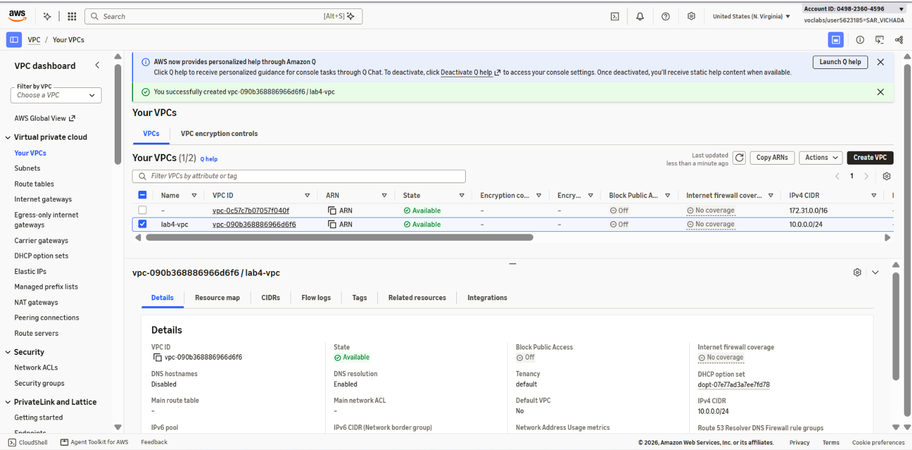

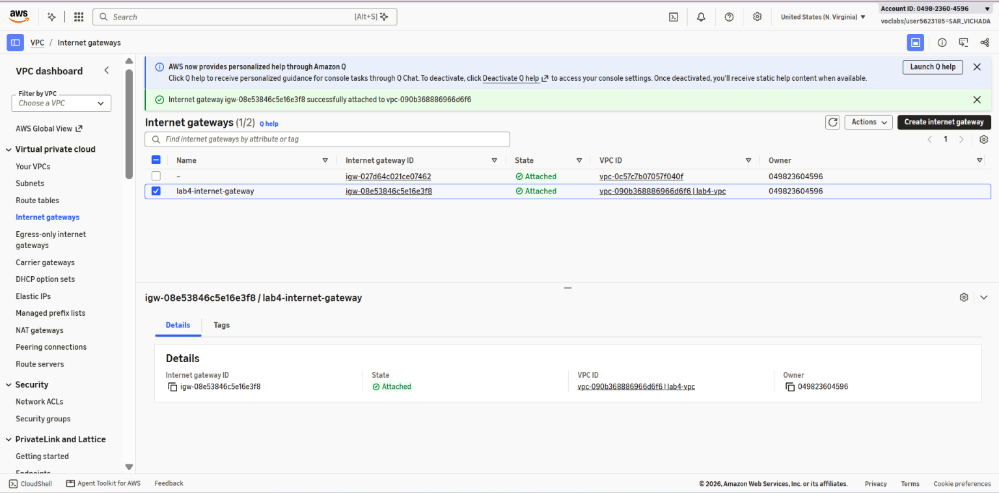

## Public subnet

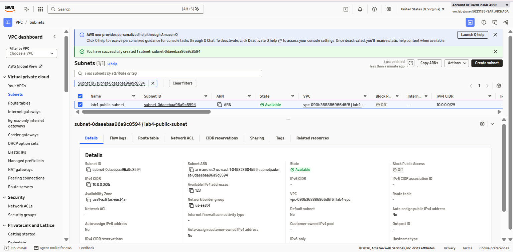

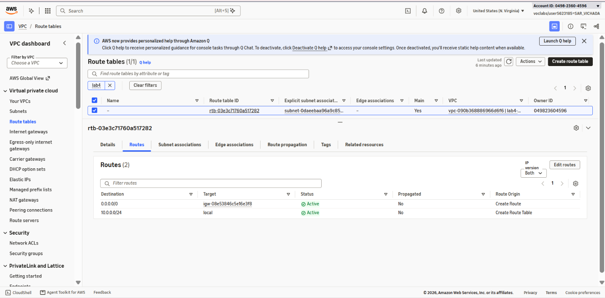

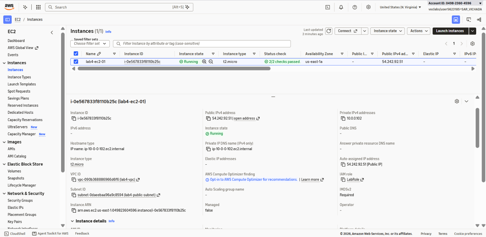

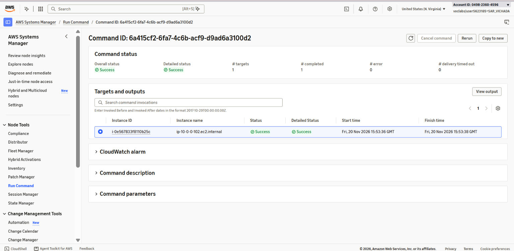

## Private subnet

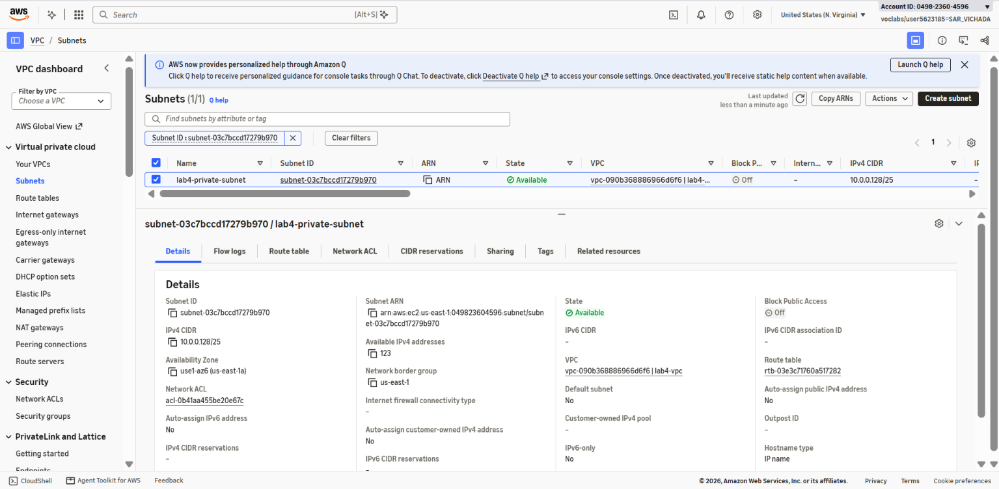

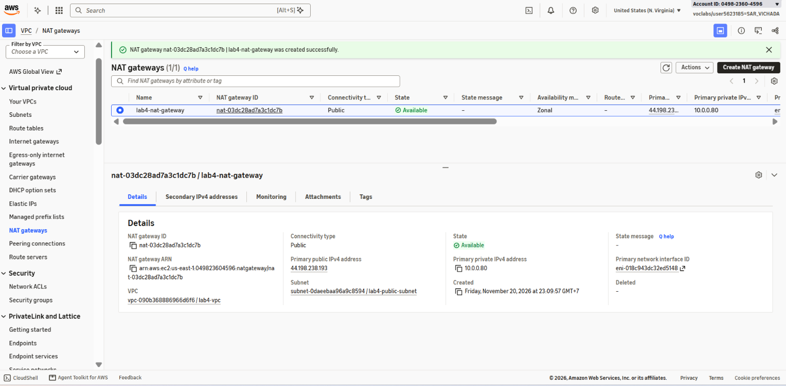

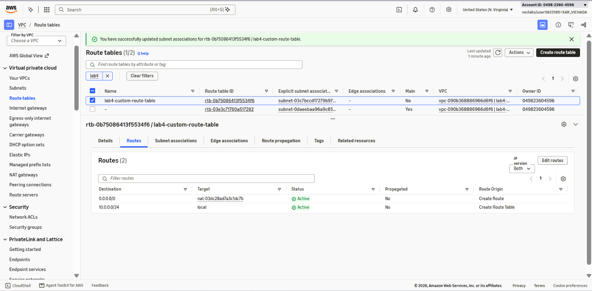

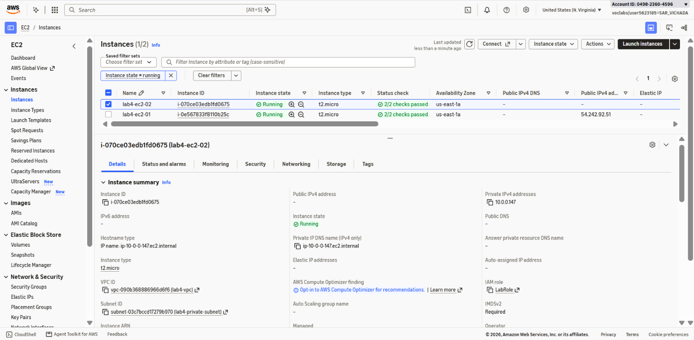

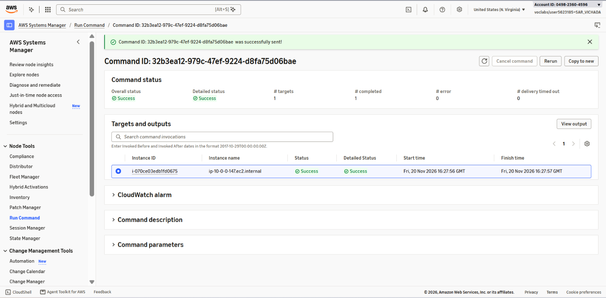

---

## Questions

1. The VPC is `10.0.0.0/24` and the subnets are `10.0.0.0/25` and `10.0.0.128/25`. How many IP addresses does each block contain, and why do the two subnets not overlap?
   => The VPC `10.0.0.0/24` has 256 addresses. Each `/25` subnet has 128 addresses (123 usable, because AWS reserves 5). `10.0.0.0/25` covers `10.0.0.0` to `10.0.0.127`. `10.0.0.128/25` covers `10.0.0.128` to `10.0.0.255`. Each takes one half of the VPC, so no address is in both.
2. Both subnets are in the same VPC. What exactly makes `lab4-public-subnet` public and `lab4-private-subnet` private?
   => The route table decides. A subnet is public when its route table sends `0.0.0.0/0` to the internet gateway. `lab4-private-subnet` has no route to the internet gateway. It sends `0.0.0.0/0` to the NAT gateway instead.
3. Why is the NAT gateway placed in the **public** subnet and not in the private one?
   => The NAT gateway needs a route to the internet gateway and an Elastic IP to send traffic out. Only the public subnet has a route to the internet gateway. In the private subnet it could not reach the internet.
4. `lab4-ec2-02` has no public IP address. Can someone on the internet open a connection to it? Can it download updates? Explain both answers.
   => No, nobody can connect to it from the internet. It has no public IP, no route sends internet traffic into the private subnet, its security group has no inbound rules, and the NAT gateway does not accept new connections from outside.
   => Yes, it can download updates. Its traffic goes to the NAT gateway, then the internet gateway, then the internet, and the replies come back the same way.
5. You tested internet access with Systems Manager instead of SSH. Why did the instances need `LabInstanceProfile` for this?
   => It gives the instance the `LabRole` IAM role, which lets the SSM agent connect to Systems Manager. Without it, the instance would not appear in Run Command and I could not send commands. This also means no SSH key and no inbound port were needed.

## Clean up

- [x] Instances terminated.
- [x] NAT gateway deleted and its Elastic IP released.
- [x] Internet gateway detached and deleted.
- [x] `lab4-vpc` deleted.
