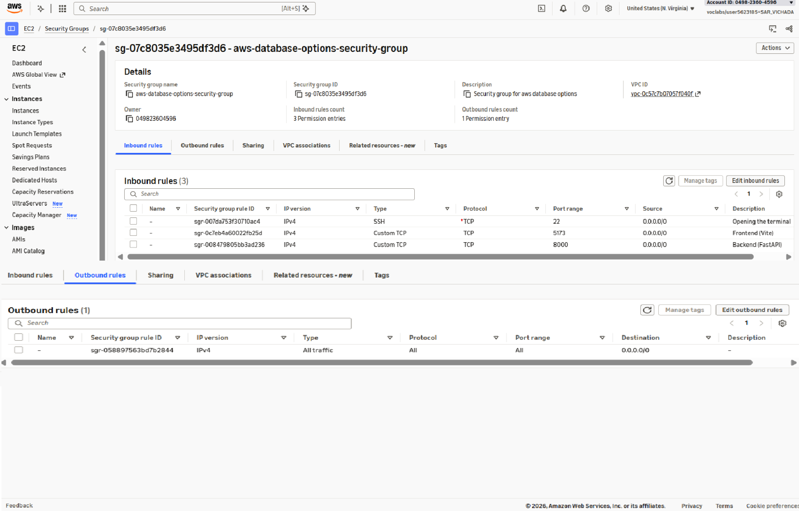
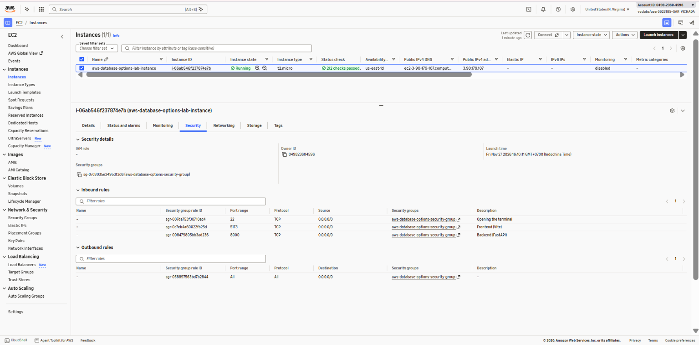
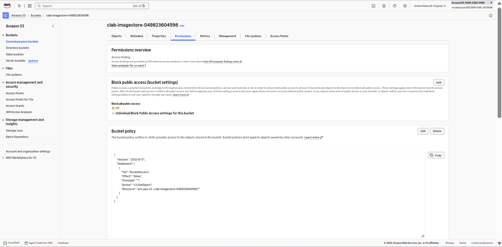
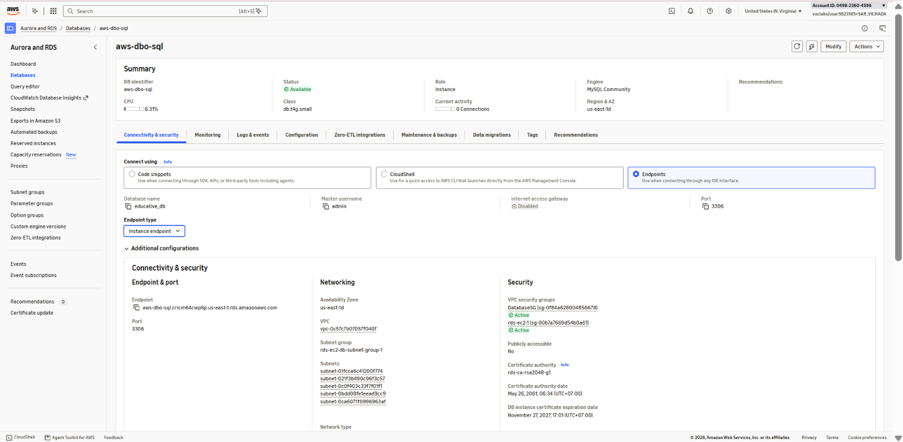
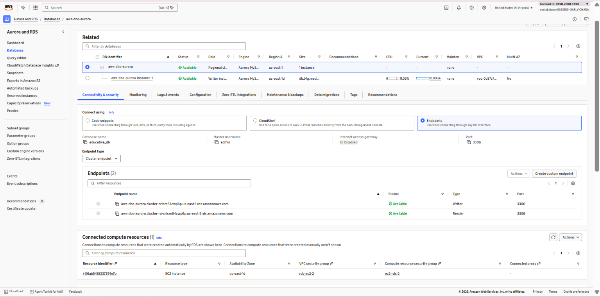
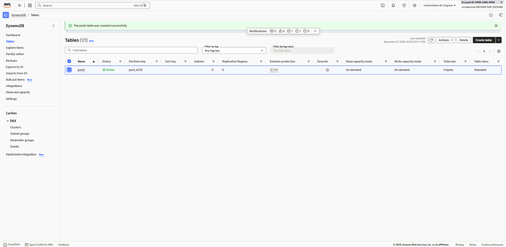
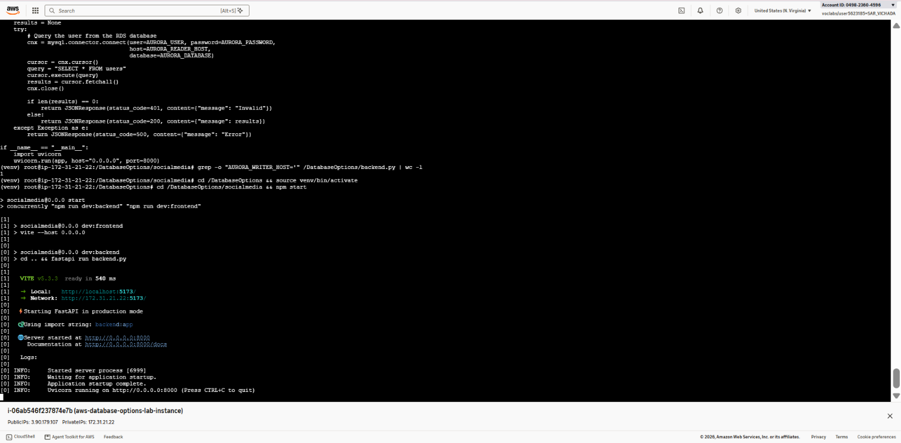
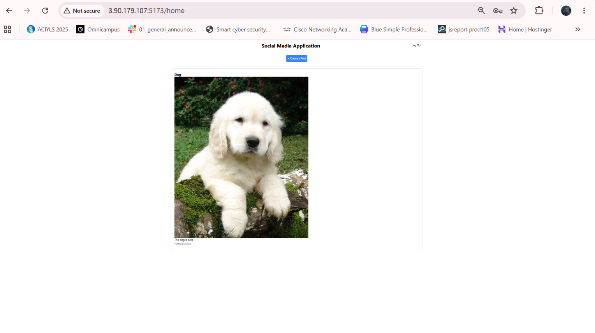
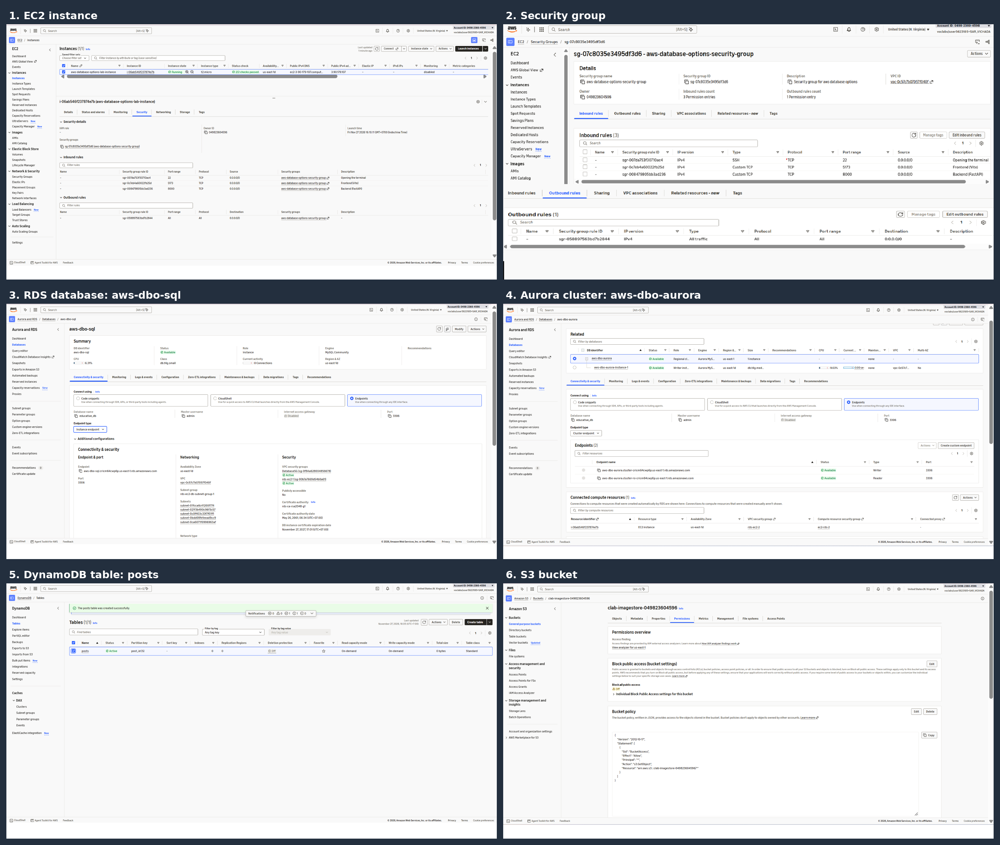
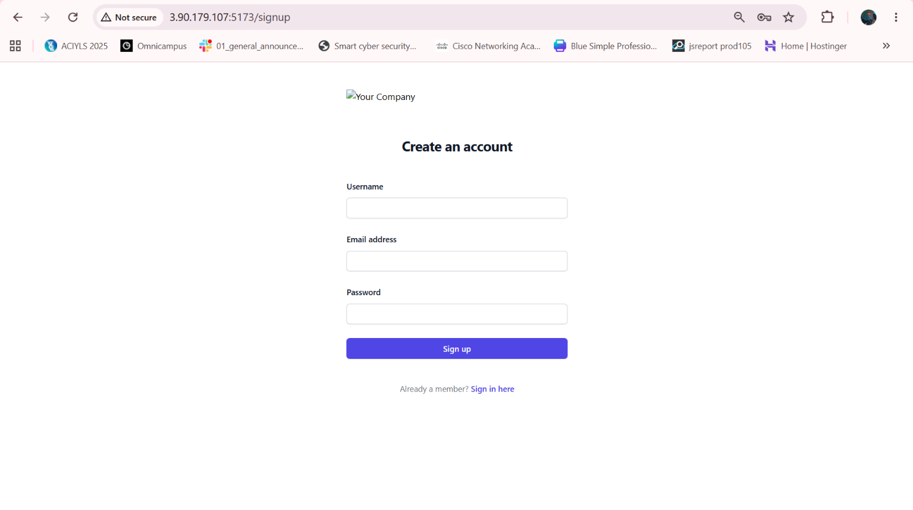

# Cloud Lab 5 Submission — AWS Database Lab

- **Student name: Sar Vichada**
- **Student ID: e20220514**
- **Learner Lab user name: user5623185=SAR_VICHADA**
- **Date completed: 27 November 2026**

---

## 1. Security Group Rules

`aws-database-options-security-group` with its inbound rules (SSH port 22, Custom TCP ports 8000 and 5173) and its outbound rule.

## 2. EC2 Instance Running

`aws-database-options-lab-instance` in the **Running** state with `aws-database-options-security-group` attached.

## 3. S3 Bucket

My `clab-imagestore-…` bucket with its public access settings and bucket policy.

## 4. RDS DB Instance

`aws-dbo-sql` with the status **Available** and its endpoint.

## 5. Aurora DB Status

The `aws-dbo-aurora` cluster with the status **Available** and its writer and reader endpoints.

## 6. DynamoDB Table

The `posts` table with the status **Active** and its partition key `post_id`.

## 7. Application Configuration and Testing

The EC2 instance terminal after `npm start`, showing that the application started.

The application running in the browser at `http://<Public_IP_of_EC2>:5173`.

## 8. Final Infrastructure

The resources I created: EC2 instance, security group, RDS and Aurora databases, DynamoDB table and S3 bucket.

## 9. Signup and Sample Post

The signup or login page and a sample post I created.

---

## Questions

### 1. Signup writes to the Aurora writer endpoint and login reads from the reader endpoint. Your cluster has no Aurora Replica. Which instance answers the reader endpoint, and why does the application still work?

The only instance in the cluster, the **primary (writer) instance** `aws-dbo-aurora-instance-1`, answers it. When an Aurora cluster has no available replica, the reader endpoint connects to the primary instance.

The application still works because both endpoints lead to the same database. Signup saves the user on that instance, and login reads the user from it.

### 2. A post is split between the `user_post` table in RDS and the `posts` table in DynamoDB. What does each one store, and how does `/get_posts` join them?

| Table | Database | Stores |
|---|---|---|
| `user_post` | RDS for MySQL | `id` (primary key) and `username`: who made each post |
| `posts` | DynamoDB | `post_id` (partition key), `title`, `content` and optional `media` (the file's S3 URL) |

The two tables are linked by the same ID value (`user_post.id` = `posts.post_id`). A SQL `JOIN` cannot reach across the two databases, so the backend joins them in Python:

1. It runs `SELECT id, username FROM user_post` on RDS.
2. For each row, it calls `get_item` on DynamoDB with `post_id` set to that `id`.
3. It adds the `username` to the DynamoDB item and puts the item in a list.
4. It returns the list.

If any ID has no matching item in DynamoDB, the whole request fails with an error.

### 3. The post ID is the username followed by the time (`%H:%M:%S`). What happens if the same user publishes two posts in the same second, or on two different days at the same time?

In both cases the two posts get the **same ID**, because the ID has no date and nothing smaller than a second.

`id` is the primary key of `user_post`, so MySQL rejects the second insert as a duplicate. This insert runs first, so the code stops before it writes to S3 or DynamoDB. The first post stays unchanged, the second post is not saved, and the backend returns "Error creating Post".

A fix is to use a unique ID such as a UUID.

### 4. Why does the post content go into DynamoDB instead of a SQL table, according to the lab's database design?

Posts do not all have the same fields. For example, some have a media file and some do not. DynamoDB only requires the partition key (`post_id`), so each item can have its own set of attributes. A SQL table has fixed columns that every row follows.

### 5. The `users` table stores the password exactly as the user typed it, and the S3 bucket allows anyone to read its objects. Name one risk of each choice.

- **Plain-text passwords:** anyone who gets access to the table can read every password and try it on the users' other accounts. In this app, the `/all` endpoint returns the whole `users` table to anyone who can reach port 8000. Passwords should be stored as salted hashes, for example with bcrypt.
- **Public S3 objects:** anyone who has or guesses a file's URL can open it without logging in, so a user's private image can be exposed. A safer design keeps the bucket private and gives out temporary pre-signed URLs.

---

## Clean up

- [x] EC2 instance terminated and `aws-database-options-security-group` deleted.
- [x] RDS instance `aws-dbo-sql` and Aurora cluster `aws-dbo-aurora` deleted.
- [x] S3 bucket emptied and deleted.
- [x] DynamoDB table `posts` deleted.
